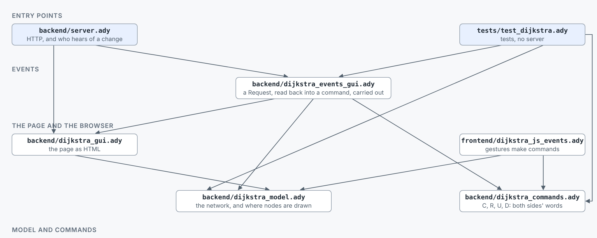

# DIJKSTRA_HTMX -- an algorithm with a GUI drawn by the server

The smallest version of the architecture of `BROWSER_EXAMPLES/ACCOUNTING`: the program is
native, the browser only shows what the server draws, and htmx carries the
clicks.

The tutorial, `docs/TUTORIAL.md`, builds it step by step: the objects in the model, their
picture, the events, and why htmx.



```
make app                      # builds dijkstra_js_events.js and the server, starts it and opens the page
make test                     # the model, the page and the requests, no server
# or by hand:
ady2nim js frontend/dijkstra_js_events.ady   # the one script of our own, frontend/dijkstra_js_events.js
ady2nim c -r backend/server.ady # then open http://127.0.0.1:8810/ (run from this directory)
ady2nim c -r tests/test_dijkstra.ady # the model, the page and the requests, no server
```

Click a node to start from, another to go to; the shortest way is drawn in
orange. The drawing is the network, and every part of it can be
created, changed and deleted: add a node or an edge, change a cost, and delete from the
right-click menu or with the Delete key. Drag a node and its edges follow; where you let go is kept. The server
keeps the network in `graph.txt` (in the directory it runs in), written after
every change; Reset puts the sample back.

| File | What it knows |
|---|---|
| `backend/dijkstra_model.ady` | the model, a placeholder: a class `Network` of `Node_T`s (a name each), `Edge_T`s and the places the reader put the nodes, with its methods (`add_node`, `remove_node`, `add_edge`, `set_cost`, `remove_edge`, `put`, `forget_places`, each `add`, `remove` or `set` refusing with a `Refusal_T` (its `message` is what the page shows), or done; `names`, `edge_at`, `text`, `build_graph`, which makes of it the graph the library's `shortest_route` wants, `TO_NIM/STDLIB/graphs.ady`); `Network(text)`, a second constructor, reads it back from text. Replace it with your own; no HTML, no HTTP. |
| `backend/dijkstra_layout.ady` | where each node is drawn when the reader has not put it somewhere: `place_of` (the places the model keeps, else `new_spot`, the layout algorithm: evenly spaced round an ellipse, in the model's order), and `inside`, which keeps a node within the drawing's margin. Compiled both ways, like the model: the server draws the page with it, and the browser's `NetworkView` moves nodes with it. |
| `backend/dijkstra_gui.ady` | how to draw it: the SVG, the buttons, the form `#state`, the menus, the text. A function from the network and what is picked to HTML: `all_html` for the page, `to_html` for the drawing and for each node and edge in it. |
| `backend/dijkstra_request.ady` | the fields of a request: `field_of` and `number_of` read them, `params_of` reads the reader's choice (`Params_T`: the start, the goal, the node clicked). No HTML, no HTTP. |
| `backend/dijkstra_events_gui.ady` | what each request does: `Session.answer(method, path, fields)` calls the model, saves, and returns the page. A `Session` holds the network and the file it is kept in. No HTTP, so the tests call it. |
| `backend/server.ady` | HTTP, and nothing else: hands each request to `session.answer`, and serves the two scripts. |
| `frontend/dijkstra_js_events.ady` | the browser side, compiled to JavaScript: moves a node and redraws its edges while the mouse moves (the server could not keep up with every frame), then sends the new place (PUT /nodes); the server keeps it and draws the page again. Every change it sends goes through `request` (in the stdlib's `browser.ady`): the method, the path and the fields by name, with the form `#state`; htmx sends it and swaps the answer into `#all`, as for a button. |
| `tests/test_dijkstra.ady` | tests of the model, and of the page through `session.answer`, as the browser would ask; nothing is started. |
| `frontend/htmx.min.js` | htmx, vendored (14 KB gzipped). |

`backend/` is native (compiled to C), `frontend/` is what the browser runs (JavaScript: our `dijkstra_js_events.ady` and the vendored htmx). The model and the layout are compiled both ways: the page carries the network, its places included, as the server keeps it (a hidden `pre#network`), and `dijkstra_js_events.ady` builds its `NetworkView` from that with the same `Network(text)`, so where a node is drawn is computed from the model, never read off the drawing.

## How it works

The routes are a small REST interface on two collections, every answer the whole page:

| Request | Does | Fields |
|---|---|---|
| `GET /all` | read: the page | `start`, `goal`, `pick`, `act` |
| `POST /nodes` | create a node | `name` |
| `PUT /nodes` | move a node (a drag) | `name`, `x`, `y` |
| `DELETE /nodes` | delete a node, and its edges | `name` |
| `POST /edges` | create an edge | `a`, `b`, `cost` |
| `PUT /edges` | change a cost | `a`, `b`, `cost` |
| `DELETE /edges` | delete an edge | `a`, `b` |
| `POST /reset` | put the sample back | |

* The **network** is the server's (the model, kept in `graph.txt`). **What the
  reader has picked** (the start and the goal) is the page's: the fields of the
  form `#state`, sent with every request, so the server keeps no session.
* Each button, field and form names its request in htmx attributes
  (`hx-post`, `hx-put`, `hx-delete`, `hx-get`; `hx-vals` for which node or edge;
  `hx-include="#state"`; `hx-target="#all"`, `hx-swap="outerHTML"`), all in
  `backend/dijkstra_gui.ady`. htmx sends it and swaps in the page that comes back.
* A gesture on the drawing (a click on a node, a drag, a wire, a double-click, a
  menu, the Delete key) has no button: `frontend/dijkstra_js_events.ady` names
  its request in one line, `send_gesture("DELETE", "/nodes", {"name": n})`, and
  the browser module's `request` sends it the same way, with `#state`, into
  `#all`. So the page holds no hidden forms or buttons for the script to fill
  in and press, and each route is named where the gesture that uses it is.
* A mistake (a name taken, an edge that is there already) comes back as a line
  in red on the page; nothing is changed.
* So testing the GUI is calling `session.answer(method, path, fields)` and reading the
  page: see `tests/test_dijkstra.ady`.
* The algorithm never learns about any of it. A different front end (a command
  line, a test) uses the model, `build_graph` and `shortest_route` unchanged.

## When it fits, and when it does not

It fits when an answer is cheap to compute and a round trip per click is fine:
algorithms, forms, tables, dashboards, a graph that is re-drawn. Everything
stays in one language, and what the browser runs is almost nothing.

It does not fit what must follow the mouse every frame. That is what
`dijkstra_js_events.ady` is for: the same language, compiled to JavaScript, doing only the
moving; the page and the answer are still the server's. A drag is the one place
where the drawing exists twice (here the straight line of an edge, in
`../ACCOUNTING/frontend/accounting_js_events.ady` the same `routes_of` the server
uses), so keep that part small.
