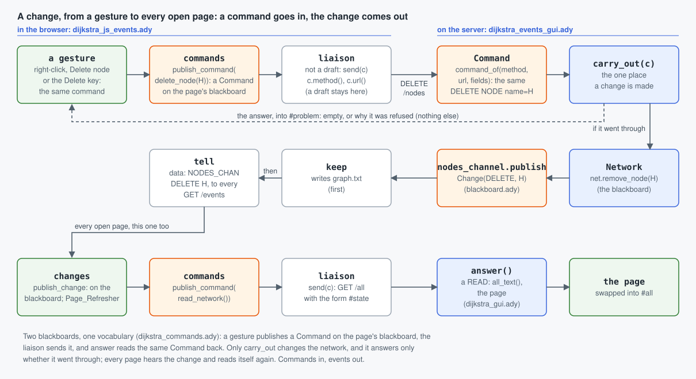
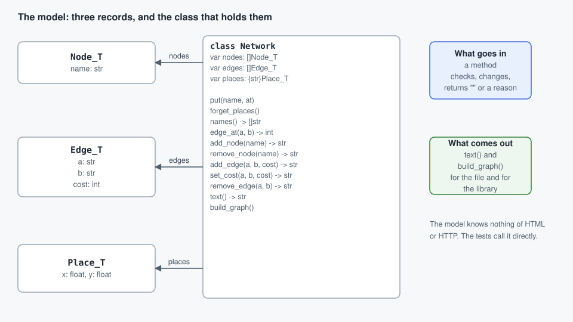
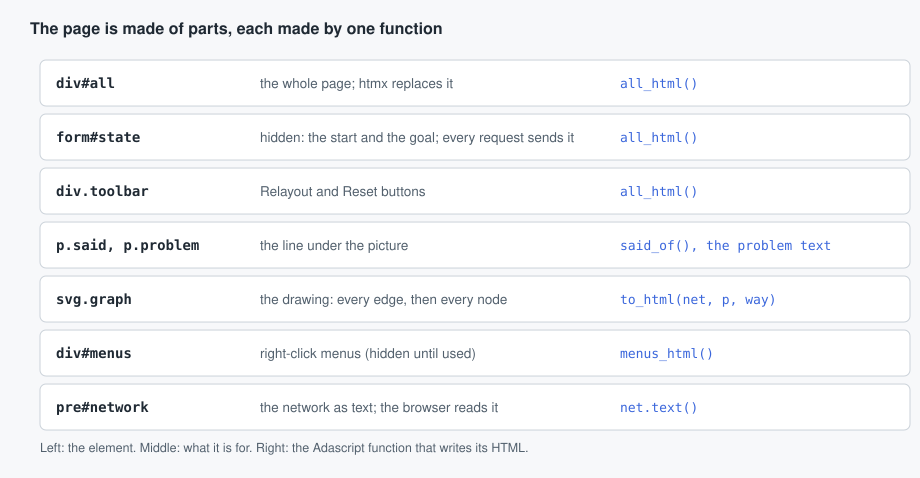
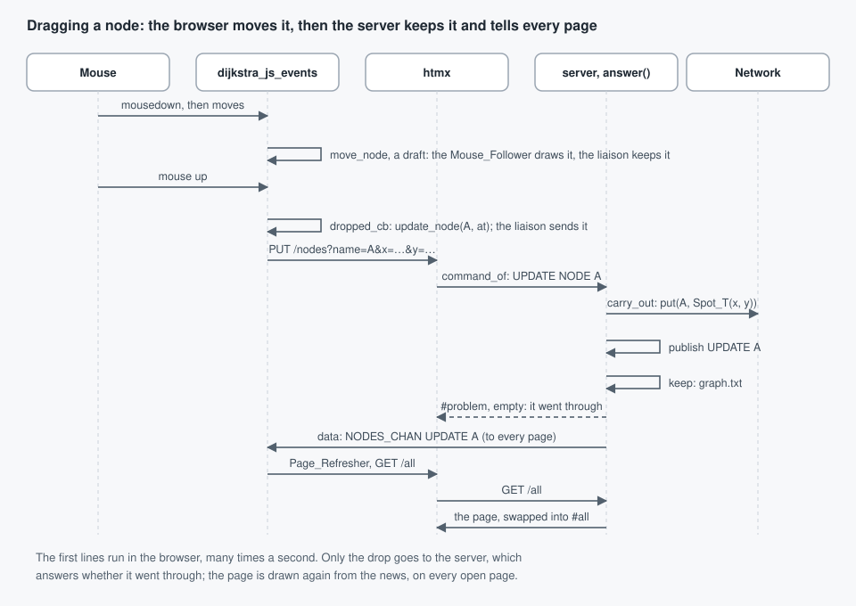
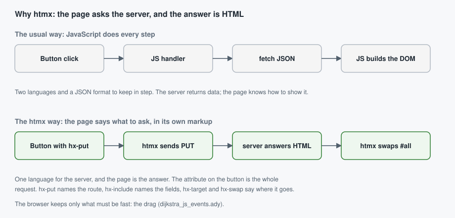

# Tutorial: a web application in Adascript, from the model to the page

This example is the smallest complete web application in Adascript. You
can run it, change it, and read every line. This tutorial follows one
thing through it, a node, from the data that holds it, to the picture
on the page, to the click that changes it. It also explains why the page
is built with htmx and how the two fit together.

```
make app                  # builds the browser script and the server, opens the page
make test                 # the model and the page, tested without a server
```

## The whole picture



A change goes in as a command, and comes out as an event that every open page hears;
each page then reads itself again. The program is split by what each part knows:

| Layer | Files | Knows about |
|---|---|---|
| The model | `backend/dijkstra_model.ady` | the data and its rules, and the layout: where each node is drawn when nobody has put it |
| The page | `backend/dijkstra_gui.ady` | how the data looks as HTML |
| The requests | `backend/dijkstra_events_gui.ady` | what each request does to the data, and the change it publishes |
| The server | `backend/server.ady` | HTTP, and who hears of a change: the file (`keep`) and every open page (`tell`) |
| The commands | `backend/dijkstra_commands.ady` | what the page can ask of the server, in words both share: C, R, U or D of a node or an edge |
| The browser | `frontend/dijkstra_js_events.ady` | the gestures, each making a command; what must follow the mouse |

Each layer only calls the one below it. The model never imports HTML,
and the server never looks inside a node. That is what makes each layer
testable on its own (see `tests/test_dijkstra.ady`).

---

## Step 1: define the objects in the model

The model says what a network is. It has two classes: a node and an edge. The page's views of them
(`NodeView`, `EdgeView`, in `frontend/dijkstra_js_events.ady`) are kinds of them, so
they are `@virtual`: a class another module inherits says so. So is `Network`, which
the page's `NetworkView` extends with the views of what it draws.
The place where the reader has put a node on the drawing is a `Spot_T`
from the library's `drawing` module: two lengths, each a `Drawing_Pixel_T`
(a length in the drawing's own units, which a plain `float` is not).

```adascript
# A node: its name.
@virtual
class Node_T:
    var name: str

    def __init__(self, name: str):
        self.name = name

# An edge: the two nodes it joins, both ways, and its cost.
@virtual
class Edge_T:
    var a:    str
    var b:    str
    var cost: int

    def __init__(self, a: str, b: str, cost: int):
        self.a = a
        self.b = b
        self.cost = cost
```

The network is a class. It holds the three lists and is changed only
through its methods:

```adascript
@virtual
class Network:
    var nodes: []Node_T                 # in the order they were made
    var edges: []Edge_T                 # each edge once
    var places: {str}Spot_T            # where the reader put a node, by name

    def __init__(self, nodes: []Node_T, edges: []Edge_T, places: {str}Spot_T):
        self.nodes = nodes
        self.edges = edges
        self.places = places
```



### Methods refuse with a failure, or succeed

Every method that changes the network returns `None | !Refusal_T`. A
refusal is a `Refusal_T`, a record whose message the page shows in red.
Success is the normal end of the method. The caller narrows the result
with `is`, the same way `parse_int` results are read, so a refusal
cannot be ignored by accident. The rules live in the model, and the
page only decides how to show them.

```adascript
type Refusal_T is record:
    message: str

def add_node(self, name: str) -> None | !Refusal_T:
    if len(name) == 0 or len(name) > 8:
        return Refusal_T(message="A name is 1 to 8 letters or digits.")
    for c in name:
        if c not in LETTERS:
            return Refusal_T(message="A name is 1 to 8 letters or digits.")
    if name in self.names():
        return Refusal_T(message=f"There is a node {name} already.")
    self.nodes.append(Node_T(name))
```

### The model is kept in text

`text()` writes the network as one line per node, edge and place, and
`Network(text)` reads it back, through a second constructor. The server saves the file after every
change, and the page carries the same text, so the browser can rebuild
the same network.

```adascript
def text(self) -> str:
    var lines: []str = []
    for n in self.nodes:
        lines.append(f"node {n.name}")
    for e in self.edges:
        lines.append(f"edge {e.a} {e.b} {e.cost}")
    for n in self.nodes:
        if n.name in self.places:
            let p: Spot_T = self.places[n.name]
            lines.append(f"at {n.name} {p.x:.0f} {p.y:.0f}")
    return "\n".join(lines) + "\n"
```

### Reading the text back: a second constructor, `case` on the first word

```adascript
for line in text.split("\n"):
    let w: []str = line.split()
    if len(w) == 0:
        continue
    case w[0]:
        when "node":
            if len(w) == 2:
                let added: str = net.add_node(w[1])
        when "edge":
            ...
```

A `case` on a string needs a `when others:` branch, so write one even
when the others do nothing. (The compiler says so if you forget.)

---

## Step 2: decide where each object is drawn

The model stores only the places the reader has chosen. Any node
without one is placed by the layout, which is a pure function of the
network, so the server and the browser agree on it without talking.

```adascript
class Network:
    ...
    # Where the node NAME is drawn: where the reader put it, else where the layout puts it.
    def place_of(self, name: str) -> Spot_T:
        if name in self.places:
            return self.places[name]
        for i in range(len(self.nodes)):
            if self.nodes[i].name == name:
                return new_spot(i, len(self.nodes))
        return Spot_T(0.0, 0.0)
```

`new_spot` spreads the nodes evenly round an ellipse. The layout's sizes are
lengths of their own: the drawing is `WIDTH = 15 cm` by `HEIGHT = 10 cm`, the
ellipse `ACROSS` and `UP` centimetres, and what is small, a node's radius or
its margin, is in pixels. The layout is the end of the model's file: both the
server (`dijkstra_gui.ady`) and the browser (`dijkstra_js_events.ady`) import
it from there, which is why it has no HTML in it.

---

## Step 3: give the objects a picture

The page is written by functions that return `Html`. An `html:` block
writes markup as Adascript code, with indentation for nesting, and a
`+` to insert another piece:

```adascript
# A node of NET: its circle (coloured by what it is to ROUTE) and name, and a port (the dot on its
# right) from which a wire is drawn to another.
def to_html(n: Node_T, net: Network, route: Route) -> Html:
    let at: Spot_T = net.place_of(n.name)
    let cx: str = f"{at.x:.0f}"
    let cy: str = f"{at.y:.0f}"
    let ty: str = f"{at.y + NAME_DY:.0f}"
    let px: str = f"{at.x + NODE_R:.0f}"
    let nr: str = f"{NODE_R:.0f}"
    let pr: str = f"{PORT_R:.0f}"
    let css: str = "node " + route.role_of(n.name)
    html:
        g class=css data_name=n.name data_x=cx data_y=cy:
            circle cx=cx cy=cy r=nr
            stext class="name" x=cx y=ty: n.name
            circle class="port" cx=px cy=cy r=pr
```

Three things to note:

- **The object is an argument.** `to_html` takes a `Node_T`, the network
  that says where it is, and the route that says what it is to the way.
  It works nothing out: the route is found once, before the drawing.
- **Attributes are names.** `class=css` puts the value of the variable
  `css`; `class="name"` puts the text. Attribute names with a dash are
  written with an underscore, `data_name` (see *Why htmx and how* below).
- **The picture of one object is one function.** The picture of the
  whole network is another, which calls these in turn:

```adascript
def to_html(net: Network, route: Route) -> Html:
    let box: str = f"0 0 {WIDTH:.0f} {HEIGHT:.0f}"
    html:
        svg viewBox=box class="graph":
            for e in net.edges:
                + to_html(e, net, route)
            for n in net.nodes:
                + to_html(n, net, route)
            path id="wire" class="wire" visibility="hidden" d="M 0 0 L 0 0"
```

What the reader has chosen is a `Choice`: the start and the goal, and `click`, which says
what a click on a node does to them (the start, then the goal, then the start again; a
chosen node clicked again is no longer chosen). The way between them is a `Route`, found
once from the network and the choice: its nodes, its cost, `uses(e)` (an edge on the way,
drawn in orange), `role_of(name)` (start, goal, way, or nothing) and `said()`, the line under
the drawing. The functions that draw only ask it.

The edges are drawn first, so each node sits on top of the lines that
end at it.

### The page is parts, and each part is one function



The whole page is `all_html`, which puts its parts in one `div`. The
hidden form `#state` holds the start and the goal, and every request
sends it along, so the requests carry the choice the reader has made.

### The look goes beside the code that uses it

The CSS of a node is defined next to `to_html` for the node, so one
place says both what a node is and how it looks:

```adascript
const NODE_STYLE: str = """
g.node { cursor: grab; }
g.node circle { fill: #fff; stroke: #7b8794; stroke-width: 2; }
g.node.start circle { fill: #e3f2e5; stroke: var(--start); stroke-width: 4; }
g.node.selected circle { stroke: var(--accent); stroke-width: 4; }
"""
```

`ALL_STYLE` joins the parts together for the page. A page-wide rule (the
body, the buttons) stays in `STYLE`.

---

## Step 4: handle the events

There are two kinds of event, and the example uses each for what it
does best.

**Most events go to the server.** A button says which command it sends. The
browser does nothing itself:

```adascript
+ page.button("Reset the sample", reset_network(), "Put the sample network back?", "quiet")
```

which writes

```html
<button type="button" class="quiet" data-hx-delete="/all" data-hx-confirm="Put the sample network back?" data-hx-target="#problem" data-hx-swap="outerHTML">Reset the sample</button>
```

The button sends a command, `reset_network()` (Delete the network: the sample is put
back), and the command says the method and the URL (see below). `page` is the app's
`Page_Of[Thing_T]`, from the standard library's `server_page.ady`, made once in
`dijkstra_gui.ady` with where a command goes (`url`) and where a change's answer goes
(`#problem`): it writes the htmx attributes (`data-hx-delete` names the request,
`data-hx-confirm` asks first, `data-hx-target` and `data-hx-swap` say where the answer
goes), so the gui never does. The same `page` makes any element send a command
(`page.sending`), a field send one when it is changed (`page.on_change`), and the shell
that loads the first page (`page.shell_text`).

**The server reads each request back into a command.** `server.ady` only matches
the path and hands the request on. `Session.answer` reads it back into the same
`Command` the page sent (`command_of` in `backend/dijkstra_commands.ady`, the vocabulary both
sides share, given the fields read once by a `Page_Request`, from the standard library's
`page_server.ady`). A read answers the page; a change goes to the method for what it is
done to (`change_node`, `change_edge`, `change_network`), which has one `case` on the verb:

```adascript
class Session:
    ...
    def answer(self, method: str, path: str, fields: str) -> str:
        let c: ?Command = command_of(method, path, Page_Request(method, path, fields).fields)
        if c is None:
            return ""
        if c.verb == READ:
            var choice: Choice = Choice(c.value("start"), c.value("goal"), self.net.names())
            choice.click(c.value("pick"), c.value("act") == "unpick")
            return all_text(self.net, choice, self.unsaved)
        case c.thing:
            when NODE:
                return problem_text(self.change_node(c))
            when EDGE:
                return problem_text(self.change_edge(c))
            when NETWORK:
                return problem_text(self.change_network(c))

    def change_edge(self, c: Command) -> None | !Refusal_T:
        let a: str = c.value("a")
        let b: str = c.value("b")
        let cost: int = c.number_value("cost")      # -1 when there is none, which the model refuses
        var refused: None | !Refusal_T = None
        case c.verb:
            when CREATE:
                refused = self.net.add_edge(a, b, cost)
            when UPDATE:
                refused = self.net.set_cost(a, b, cost)
            when DELETE:
                refused = self.net.remove_edge(a, b)
            when others:
                pass                                # an edge is not read (command_of)
        if refused is None:
            self.edges_channel.publish(Change(c.verb, f"{a} {b}"))
        return refused
```

The routes are listed in a comment above `answer`, in the class. **Commands in, events
out.** The read, `GET /all`, answers the whole page, which htmx swaps into `#all`. A
command (POST, PUT, DELETE) answers only whether it went through: the paragraph
`#problem`, empty, or saying why not. When it went through, each change is published
on a channel (stdlib's `blackboard.ady`): `NODES_CHAN` or `EDGES_CHAN` carries a `Change`, such as
`CREATE H`. The Session does not know who listens. The server does: `keep` writes the
network to its file, and `tell` writes the change to every open page (`GET /events`,
server-sent events: page_server's `News`), which reads itself again. So every page, the one
that made the change too, is drawn the same way: from the news. A request with an unknown path returns
`""`, and the server answers 404. The picture at the top, "The whole picture", draws this path.

**Some events stay in the browser.** A drag must follow the mouse many
times a second, and a server round trip for each move would be too slow.
Those are in `frontend/dijkstra_js_events.ady`, which is compiled to
JavaScript with `ady2nim js`.

**A gesture makes a command; one place sends it.** What the page can ask of the
server is four verbs on two things, Create, Read, Update or Delete of a node or an
edge, and each is a `Command`, in `backend/dijkstra_commands.ady`, which is compiled
both ways, like the model, so the server reads a request back into the same `Command`.
The verbs and what a command is are the standard library's (`commands.ady`: a
`Command_Of` a thing, with its fields, read with `c.value(name)`); what the things are,
and the URL of each, are the app's:

```adascript
from commands import Verb_T, CREATE, READ, UPDATE, DELETE, Command_Of

type Thing_T is enum NODE, EDGE, NETWORK
type Command is Command_Of[Thing_T]

def delete_node(name: str) -> Command:
    let fields: {str}str = {"name": name}
    return Command(DELETE, NODE, fields)
```

A gesture only says which command it means. The Delete key, Backspace and the
right-click menu's "Delete node" are three gestures and one command:

```adascript
commands_channel.publish(delete_node(self.name))
```

`commands_channel` is the page's own blackboard (see "Two blackboards and
a liaison" below), and the gesture is done: it does not know who carries it out. For
a command that is the model's, that is the liaison's `callback`, the one place a command meets the
server: the verb is the HTTP method (POST, GET, PUT, DELETE: `c.method()`), the thing is
the URL (`/nodes`, `/edges`, `/all`: `c.url()`), the reader's choice (`#state`) goes along, and the
browser module's `send_request` sends it, as a button with hx-* attributes would. The
answer to C, U or D goes to `#problem` (whether it went through); a read's, the page,
to `#all`.

| Gesture | Command |
|---|---|
| click a node | R `read_network(name, unpick)` |
| double-click the space, or the menu's "New node here" | C `create_node(name, at)` |
| drag from a node's dot to another node | C `create_edge(a, b, cost)` |
| drag a node (a draft, many times a second) | U `move_node(name, at)` |
| let go of a dragged node | U `update_node(name, at)` |
| double-click an edge, or the menu's "Change cost" | U `update_edge(a, b, cost)` |
| Delete, Backspace, or the menu's "Delete" | D `delete_node(name)` or `delete_edge(a, b)` |
| a change, from any page (the news) | R `read_network("", False)` |

Which of a node and an edge the Delete key deletes is the selection's to say:

```adascript
class Selection:
    var what: NodeView | EdgeView | None
    ...
    def remove(self):
        let picked: NodeView | EdgeView | None = self.what
        case picked:
            when NodeView | EdgeView:
                picked.delete()
            when None:
                pass
```

What the reader last clicked is a node's view, an edge's view, or nothing, and
the field says so in its type: there is no tag to keep in step with the value.
`case` over a union tests the *type* of each member and narrows, with no cast.
`when NodeView | EdgeView` shares one body between two members: it is checked
once for each, so `picked.delete()` has to exist on both. Every member has to
be named, `None` included. A `case` over an enum, an int or a
string compares *values* instead, and a choice that compares different things
still needs an `if` chain: `Route.role_of` in `dijkstra_gui.ady` is one.

---

## The blackboard: who hears of a change

Step 4 sends every change through a channel, and nobody calls `keep` or `tell` by name.
That is the *blackboard* pattern, an old one from AI systems, where independent experts
work on one shared problem without talking to each other. It has three parts:

| Part | What it is | Here |
|---|---|---|
| The blackboard | the shared state everyone works from | the `Network` |
| The control | decides what is written on it, and when | `Session.answer`: checks a command, applies it, says what changed |
| The knowledge sources | each reacts to a change, knowing nothing of the others | `keep` writes `graph.txt`; `tell` writes to every open page |

What ties them together is a channel per kind of change, from the standard library's
`blackboard.ady`. A blackboard has a handful of channels, known when it is written, so
they are named by an enum of its own, not by strings. The reader sees every channel there is
in one line, `Channel_T`, and a misspelt channel does not compile.

A `Change` (from `commands.ady`, like the verbs) is a verb, `kind`, and a `key`: the node's
name, or the edge's two ends; "" for everything.

```adascript
from blackboard import PublishChannel
from commands import Change

type Channel_T is enum NODES_CHAN, EDGES_CHAN

type Change_Channel_T is PublishChannel[Channel_T, Change]    # a channel of Channel_T, carrying a Change

class Session:
    var nodes_channel: Change_Channel_T = Change_Channel_T(NODES_CHAN)    # what happened to a node
    var edges_channel: Change_Channel_T = Change_Channel_T(EDGES_CHAN)    # what happened to an edge
    ...
        if problem is None:             # only what went through is told
            for ch in node_changes:
                self.nodes_channel.publish(ch)
```

and the server says who listens, once, at start:

```adascript
session.nodes_channel.subscribe(keep)           # kept first, so a page that reads again sees it saved
session.nodes_channel.subscribe(tell)
```

Four rules follow from it:

1. **The control knows no listener.** `answer` publishes `Change(CREATE, "H")`; whether
   that is saved, sent to three tabs or logged is decided elsewhere.
2. **A new capability is a new subscriber**, not an edit of `answer`. Undo is a
   subscriber that keeps the changes in order (a `Change` is already a history entry,
   and `keep_history` keeps the last ones); a log is one that writes them out.
3. **Only what went through is told.** A refused command publishes nothing, so no
   knowledge source ever sees a change that did not happen.
4. **Everything happens at once.** `publish` calls each subscriber in turn, in the order
   they subscribed, and returns when all have run: there is no queue and no thread.
   That is why `keep` goes before `tell`.

The test is a knowledge source too: it subscribes a function that writes down what it
hears, and checks the list (`tests/test_dijkstra.ady`).

A subscriber is a plain function, `(channel: Channel_T, change: Change) -> None`, so what it
needs (the session, the open pages) it finds at module level, as `keep` and `tell` do in
`server.ady`.

### Two blackboards and a liaison

The page is built the same way. Its blackboard has two channels. What every such page
has is the standard library's `page_board.ady`: the channels' names (`Page_Channel_T`:
`COMMANDS`, `CHANGES`), `changes_channel`, what the server says changed, and the liaison.
What carries this app's own commands is in `frontend/dijkstra_js_events.ady`:

```adascript
from page_board import Page_Channel_T, COMMANDS, changes_channel, Liaison_Officer

type Command_Channel_T is PublishChannel[Page_Channel_T, Command]
var commands_channel: Command_Channel_T = Command_Channel_T(COMMANDS)  # what the reader asks
```

Every gesture publishes a command on `commands_channel`, and nothing else. Who
carries it out is decided by subscribing:

| Observer | Hears | Does |
|---|---|---|
| `Liaison_Officer` (page_board's) | `commands_channel` | the liaison officer: sends to the server what is the server's |
| `Mouse_Follower` | `commands_channel` | draws a draft here and now: the node still held, and its edges |
| `Page_Refresher` | `changes_channel` | asks for the page again (`read_network`), which goes out through the liaison |

Each is an `Observer` (the stdlib's `blackboard.ady`): an object that subscribes itself to
the channel it is made with, so making it is subscribing it, and what it keeps it keeps
in its own fields. Its method `callback` is what it does with what it hears; that is all
a kind of observer has to write.

The liaison decides by what a command *means*, not by which gesture made it or how
often it comes: a **draft** (`move_node`, a node the reader still holds) changes only
the page, so it stays in the browser; anything else is the model's, and the model is
changed in one place, the server's. Speed follows without being the rule: what changes
only the page is exactly what comes many times a second. Its other half: the liaison
listens to `GET /events` as it is made, and puts what that says on `changes_channel`.

The liaison is the same in every such page but for three things, which the app gives it
when it makes it: the URL a command goes to (the app's `url`), where a change's answer goes
(`#problem`), and the form a read takes along (`#state`, the reader's choice). It works
for any kind of command, so it is generic in the app's things, `Thing_T`:

```adascript
let liaison: Liaison_Officer[Thing_T] = Liaison_Officer[Thing_T](commands_channel, url, "#problem", "#state")
let mouse_follower: Mouse_Follower = Mouse_Follower(commands_channel)
let page_refresher: Page_Refresher = Page_Refresher(changes_channel)
```

So the two ends have one shape: a blackboard, subscribers that know nothing of each
other, and between the two blackboards the wire, crossed in one place each way (`callback`
out, `news` in). A new thing for the page to do with a command, an undo list, a log,
drawing a deletion before the server confirms it, is one more observer on `commands_channel`,
and no gesture changes.

---

## Step 5: a drag, from the mouse to the page



Read it from the top:

1. **While the mouse moves**, `Pointer.moved` runs in the browser. It publishes a
   draft, `move_node(name, at)`; the `Mouse_Follower` puts the node where the mouse is,
   the page's model takes the new place, and `NetworkView.redraw_edges` draws every edge
   that ends at it. The liaison leaves a draft in the browser: nothing goes to the server yet.
2. **On release**, `Pointer.dropped` publishes the command `update_node(name, at)`, which
   is not a draft, and the liaison sends it.
3. **htmx sends** `PUT /nodes`. `Session.answer` puts the place into the model
   and publishes `UPDATE A`; the server keeps the file and tells every page.
4. **Every page reads itself again** (`GET /all`, into `#all`). For this one the new
   page is the same as the one it was showing, now drawn from the server's copy.

Here the browser and the server both compute the drawing, which is why
`place_of` is shared: both call the same method on the same network.

---

## Why htmx, and how



**Why.** The usual way to make a page change is a JavaScript handler
that fetches JSON and builds the DOM. Then the JavaScript has to know
how the data looks, and the server has to send it in a format that the
JavaScript expects. htmx removes the middle step: the server sends
HTML, and htmx puts it where the attributes say. The page is always what
the server last drew, so there is nothing to keep in step.

**How.** A button, a form or a `div` carries the request in attributes, which
`server_page.ady` writes from a command (the app's gui does not):

| Attribute | Means |
|---|---|
| `data_hx_get="/all"` | send GET to `/all` |
| `data_hx_post`, `data_hx_put`, `data_hx_delete` | send that method |
| `data_hx_include="#state"` | send the fields of these forms with it |
| `data_hx_target="#all"` | put the answer in this element |
| `data_hx_swap="outerHTML"` | replace the target, not its contents |
| `data_hx_confirm="..."` | ask first, and send only on yes |
| `data_hx_trigger="load"` | send when the element appears (the first page) |

In an `html:` block the attributes would be written with underscores,
since an Adascript name cannot contain a dash (`data_hx_post`); the block
writes each `_` as `-`, so the page has `data-hx-post`, the name htmx
reads.

**State.** The network is on the server. The choice the reader has made
(the start and the goal) is in the form `#state`, which every request
sends along. So the server keeps no session, and any page can be
rebuilt from what the request carries.

**Errors.** A refused change answers with the reason, in a red line
(`#problem`), to the page that asked; nothing is published, so no other
page hears of it. Nothing is half-done: the model either did the
change or returned a `Refusal_T`, and the page shows which.

---

## Try it yourself

Each of these changes one layer, so you can see the others not change.

1. **Add a field to the model.** Give `Node_T` a `colour: str`, change
   `add_node` to take it, and make `text()` and `Network(text)` keep it. The
   page does not change until you draw it.
2. **Draw the field.** In `to_html(n: Node_T, …)`, use `n.colour` for the
   circle's `fill`, and add its rule to `NODE_STYLE`.
3. **Add a route.** Add `when "POST /relabel":` to `Session.answer`, read a field
   with `r.field("colour")`, call a new method, and publish `Change(UPDATE, name)` when it went
   through. Add a command for it in `dijkstra_commands.ady`, and put a button for it
   in the toolbar: `page.button("Relabel", relabel_node(name, "red"))`.
4. **Test it without a server.** In `tests/test_dijkstra.ady`, call
   `after("POST", "/relabel", "name=A&colour=red")` (the command, then the page read
   again) and check the page contains `red`.

Run `make test` after each step. The model and the page are checked
without a browser; the drag is checked in the browser only.
