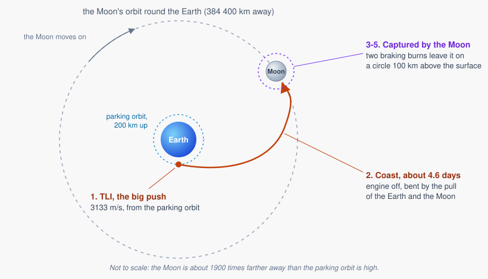
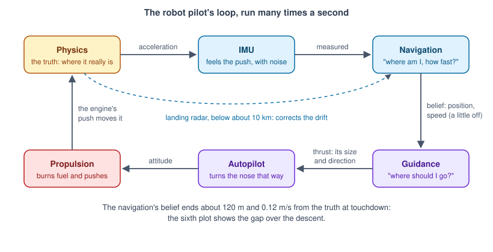
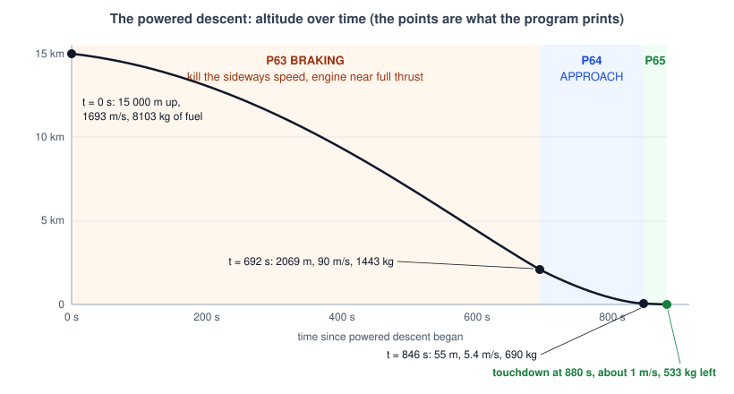
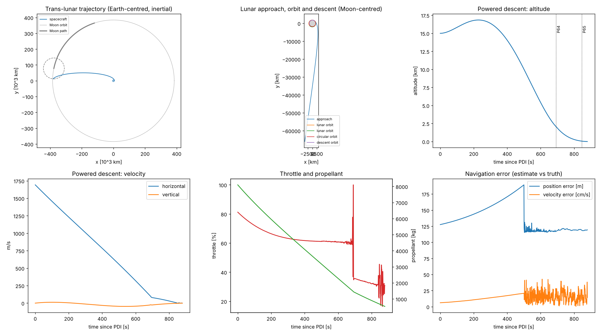

# MOON -- fly a spacecraft from the Earth to the Moon, and land it

`moon_sim.ady` is a small flight simulator. It does not draw a game: it works out, with the real laws
of gravity and the rocket equation, what an Apollo-style mission would do, prints each step, and at
the end draws six plots. It takes about 2.5 seconds to run.

    ady2nim c -r moon_sim.ady --out moon_mission.png

No spaceflight knowledge is assumed below.

## The idea in one picture

Nothing flies in a straight line. A spacecraft is thrown towards the Moon by one big push, then
**coasts for about five days** while Earth's and the Moon's gravity bend its path. Near the Moon it
slows down with rocket burns so that the Moon's gravity can catch it, and it settles into a circle round
the Moon. A lander then separates, drops out of that circle, and flies down to the surface with its
engine pointing against its motion.



## The mission, step by step

Each step below is one thing the program prints. A **burn** is a rocket firing; its size is measured by
**delta-v**, the change of speed it gives, in metres per second. Bigger delta-v needs more fuel.

1. **TLI**, "trans-lunar injection": leave the Earth. The third stage (S-IVB) gives 3133 m/s of
   delta-v and is then dropped.
2. **Coast**: about 4.6 days with the engine off. The program steps the real motion forward in time,
   under the pull of both the Earth and the Moon (which moves along its own orbit meanwhile).
3. **SOI**, "sphere of influence": the point where the Moon's pull starts to matter more than the
   Earth's, 66 000 km from the Moon, at 890 m/s relative to it.
4. **LOI-1**, "lunar orbit insertion": slow down by 771 m/s at the closest point (100 km above the
   surface), or the spacecraft would fly past. Now it is orbiting the Moon in an oval.
5. **LOI-2**: a small second burn (42 m/s) makes the oval a circle, 100 km above the surface.
6. **Undock**: the lander (LM) separates from the command ship (CSM), which stays in orbit.
7. **DOI**, "descent orbit insertion": a 19.5 m/s nudge lowers the lander's closest point to 15 km.
8. **PDI**, "powered descent initiation": at that low point, 625 km before the landing site, the
   lander fires its engine for about 15 minutes and lands.

The burns, as the program sums them up at the end:

| burn  | stage | delta-v (m/s) | propellant (kg) |
|-------|-------|--------------:|----------------:|
| TLI   | S-IVB |        3133.1 |          67 913 |
| LOI-1 | CSM   |         770.6 |           9 786 |
| LOI-2 | CSM   |          41.6 |             462 |
| DOI   | LM    |          19.5 |              97 |

The size of each burn comes from the **rocket equation**: the fuel used is `m0 * (1 - exp(-dv / ve))`,
where `m0` is the mass before the burn and `ve` the speed of the exhaust. That is why the heavy first
burn needs 68 tonnes of propellant and the last one only 97 kg.

### Why "shooting"?

The Moon is moving while the spacecraft coasts. For the spacecraft to arrive at exactly 100 km above
the surface, it must leave the Earth when the Moon is at the right place on its orbit. The program does
not know that angle, so it tries a value, flies the whole coast, sees how far off the arrival is, and
adjusts, until the miss is zero (a root finder, Brent's method). It comes out as a correction of about
-6.1 degrees. Nothing is "teleported" to make the arrival work.

## The landing: a robot pilot

The last ten minutes are the interesting part. The lander is slowed from **1693 m/s** (faster than a
rifle bullet) to about **1 m/s**, in 15 km of height and 625 km of distance, by a pilot that is a
program. It repeats one loop many times a second:



* **Physics** is the truth: where the lander really is.
* **IMU** (inertial measurement unit) is what the lander can feel, with random noise added.
* **Navigation** turns that into a *belief* about position and speed. The belief is a little wrong, and
  the sixth plot shows by how much (about 120 m and 0.12 m/s at touchdown).
* **Guidance** compares the belief with where the lander wants to be and chooses a thrust direction and size.
* **Autopilot** turns the craft to point that way, and **Propulsion** burns fuel and pushes.

The descent has three phases, as in Apollo, named after computer programs of the real lander:

* **P63, braking**: kill the 1700 m/s sideways speed, the engine near full thrust.
* **P64, approach**: from about 2 km up and 90 m/s, aim at the landing spot.
* **P65, terminal**: from 55 m up and about 5 m/s, come in gently.



Noise is generated from a fixed **seed**, so the same seed gives the same landing every time
(`--seed N` changes it).

## What the program prints

```
TLI dv = 3133.1 m/s            <- the push that leaves the Earth
ENTERED LUNAR SOI   66170 km   <- the Moon's gravity starts to win
LOI-1 dv = 770.6 m/s           <- slow down to be captured
LOI-2 dv = 41.6 m/s            <- make the orbit a circle
DOI dv = 19.5 m/s              <- lower the lander's low point to 15 km
t+ 692s P64-APPROACH ...       <- phase changes, with altitude, speed and fuel left
TOUCHDOWN
  Contact velocity : -0.86 m/s vertical, -1.15 m/s horizontal    <- gentle enough to land
  Landing miss     : -236 m (+ = long)                           <- how far from the target spot
  Descent prop left: 533 kg                                       <- fuel still in the tank
Mission time : 132.60 h (5.53 d)
```

## The six plots (`moon_mission.png`)

The top row, left to right, then the bottom row:

1. The trip to the Moon, seen from the Earth (the Moon's own orbit dotted, its path grey).
2. The approach, the circle and the descent, seen from the Moon.
3. Descent: altitude over time. Dotted lines mark the P64 and P65 phases.
4. Descent: horizontal and vertical speed. The sideways speed is cut almost to nothing.
5. Throttle (% of full thrust) and propellant left (kg). The spikes are the pilot adjusting.
6. Navigation error: how far the lander's belief is from the truth, in metres and cm/s.



## What the code is made of

The program is about 1400 lines. Reading it top to bottom follows the story:

| part of `moon_sim.ady` | what it does |
|------------------------|--------------|
| units (`Mass_T`, `Force_T`, `Mu_T`, ...) | every number carries its unit, so a speed cannot be added to a mass, and the compiler checks it |
| constants, `vis_viva`, `orbital_elements` | the physics of orbits: how fast to go at each height, the shape of an orbit |
| `integrate`, `brentq` | the equation solvers: advance the motion in small adaptive steps, and find the Moon's starting angle |
| `Spacecraft`, `Stage_T` | the ship's stages, their masses and engines, and the rocket equation |
| `Mission` | the sequence above, from TLI to the descent |
| `IMU`, `Navigation`, `Guidance`, `Autopilot`, `Propulsion` | the landing pilot |
| the plotting at the end | the six plots |

The units are the point of the exercise: the program is a test that Adascript can handle a real
calculation with checked units (metres, seconds, kilograms, degrees) on one of its two backends.

---

## About this translation

`moon_sim.ady` is [`moon_sim.py`](moon_sim.py) (a 2-D, Apollo-style mission: TLI, a trans-lunar coast,
LOI-1/LOI-2, undock, DOI, then a closed-loop powered descent through
IMU -> Navigation -> Guidance -> Autopilot -> Propulsion) written in Adascript.

    ady2nim c -r moon_sim.ady --out moon_mission.png      # about 2.5 s
    make test-moon

**Nim only**: it imports `map_base.ady` (the standard library, `TO_NIM/STDLIB`) and `MAP_UTILS/map_flat.ady` for its units and flat-plane geometry, and those
files are Nim only (they do `from math nimport ...`; `ady2py` cannot run it). The first version of this
example had its own `Vec2` and ran on both backends, with identical output; this one trades that for
the shared types.

The deterministic part of the mission is the original's to the digit (TLI 3133.1 m/s, LOI-1 770.6,
LOI-2 41.6, DOI 19.5, perilune 100.0 km at 2446.1 m/s, mission time 132.60 h); `make test-moon`
checks those lines. The powered descent is noisy, so its landing differs a little from the original's
(seed 1: 880 s, -0.86 m/s vertical, 533 kg of propellant left, against 868 s, -1.13 m/s, 601 kg) and
the six plots have the same shape as `moon_mission.png`. Matplotlib is needed to plot, through
`pyimport`; `make test` skips the run when it (or nimpy) is not installed, and only compiles.

## What differs from the Python

| moon_sim.py | here |
|-------------|------|
| `scipy.integrate.solve_ivp(..., method="DOP853", events=...)` | `integrate`: an adaptive Dormand-Prince 5(4) with terminal events, found by bisection. scipy cannot be called from Nim with a callback, and writing it in Adascript made the Nim build possible. Same tolerances (rtol 1e-10, atol 1e-3, max step 1800 s / 30 s); the orbit comes out the same to the printed digits |
| `scipy.optimize.brentq` | `brentq`, Brent's method, ported |
| numpy arrays | map_flat's `Position` (a point) and `Vector` (a displacement); `State_T` is a position and a velocity, `Delta_T` what it changes by per second. numpy is not imported at all |
| `np.random.default_rng(seed)` | `Rng`, L'Ecuyer's combined generator with Box-Muller, so the Python and Nim runs draw the same noise. The descent's noise therefore differs from numpy's for the same seed |
| `Stage` dataclass, `Spacecraft` | `Stage_T`, a record whose fields are `Mass_T`, `second_T` and `Force_T`, held by `Spacecraft`. The original shares one `Stage` object between the stack, the burn and `Propulsion`; here a stage is found by its `StageId_T`, so nothing is shared |
| `dict(...)` for orbital elements, gates, telemetry | records: `Elements_T`, `Gate_T`, `Target_T`, `Telemetry_T`, `Result_T` |
| strings for stage names, burn labels, guidance modes, phases | enums (`StageId_T`, `Burn_T`, `Mode_T`, `Phase_T`, `Event_T`) with name tables (`STAGE_NAME`, `BURN_NAME`, `MODE_NAME`) |
| event functions with `.terminal` / `.direction` attributes | `Event_T` and `EVENT_DIRECTION`; a `Dynamics` class (`EarthDynamics`, `MoonDynamics`) says what it watches |
| `lambda d: self._signed_periapsis(d) - target` | `PhaseError`, a `Scalar_Fn` with a `value` method: functions here do not close over variables |
| `float("nan")` for "no arrival" | `?float` from `signed_periapsis`, `1e30` where Brent needs a number |
| `orbital_elements` also returned `a`, `energy`, `apoapsis` | only what the program reads: radius, speed, `h`, `e`, periapsis |
| `Guidance.t_go` is `None` until set | `t_go` and `has_t_go` |
| `argparse` | a small loop over `$@` with an enum for what is expected next |

## Units

No bare floats in signatures. From map_base and map_flat: `metre_T`, `Degree_T`, `SquareMeters_T`, `Vector`,
`Position`, `Kilometers_T` and `Radians_T` (scaled units: `Kilometers_T(m)`, `Degree_T(r)`), `modulo`, and `rotated_by` / `angle` / `unit` / `cross` for the rotations and
signs the original did with `rot`, `arctan2` and `np.sign`. Declared here: `Mass_T`, `second_T`
(distinct), `Speed_T`, `Accel_T`, `Force_T`, `Mu_T` (a body's GM), `AngularRate_T` and `AngMom_T` (derived).
The rocket equation is `ve = isp * G0` (a `Speed_T`), `used = m0 * (1 - exp(-dv / ve))` (a `Mass_T`),
gravity is `MU_MOON / (r * r)` (an `Accel_T`), the Moon's phase is a `Degree_T` advancing at an
`AngularRate_T`, and a burn's delta-v cannot be added to a mass.

Dot and cross products keep their unit: `r . v` and `r x v` are `AngMom_T` (m^2/s), `along` divides one by
the unit vector's length to get a `Speed_T`, and the integrator's error control is a generic `scaled[T]` that
compares an error in metres with a tolerance in metres and one in m/s with one in m/s. A rate is a
`second_T` away from its distance (`dx / SETTLE` is a `Speed_T`), a throttle is a `Throttle_T`, and the
log prints a time as `Hours_T(t)` or `Days_T(t)` and a distance as `Kilometers_T(d)`.

What still goes through a plain float (each is in `TODO.md`):
`sqrt`, `exp`, `ln` and `**` of a unit (`vis_viva`, `half_period`, the Moon's mean motion, the random
walk's `sqrt(dt)`); the eccentricity vector, whose `v^2 - mu/r` has no unit; the mass flow `force / exhaust`;
the sign of an event, which is the same function for metres and for m^2/s; the arithmetic of the integrator
and Brent's method, which is on dimensionless step fractions; an arc length, `radius * angle`, because a
radian has no unit; an `int` beside a float (`fraction`); and the numbers handed to matplotlib.

Velocities and accelerations are map_flat's `Velocity` (`Speed_T` along a bearing) and
`Acceleration` (`Accel_T` along a bearing), with `Vector / t -> Velocity`,
`Velocity * t -> Vector`, `Velocity / t -> Acceleration` and `Acceleration * t -> Velocity` (`*` and `/` are
overloaded on the type of the right-hand side: a plain number scales, a `second_T` changes the unit);
the integrator's state is a `Position` and a `Velocity`, and a step of it is a `Vector` and a `Velocity`.
So `r + v * dt` checks, and `r + v` does not.
